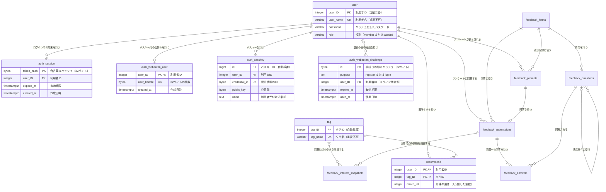

# データベース構成

MyTechPulseがデータを保存している場所（データベース）の構成をまとめたもの。実際の定義は`server/db/migrations/`（変更履歴の一式）にあり、この文書はその内容を人が読める形に書き起こしている。

- データベースの種類: PostgreSQL 17（Dockerコンテナで起動する）
- データベース名: `mytechpulse`
- 文字の扱い: UTF-8
- テーブルの作成・変更: マイグレーション（goose）で行う。`server/cmd/migrate`が、まだ適用していない変更を順に実行する。何度実行しても、適用済みのものは繰り返さない
- 本番へは「**追加するだけ**」の変更に限る。列や表の削除・名前変更などは、自動検査（`server/db/migrations/additive_test.go`）で止まる。API入れ替えに失敗して前の版へ戻ってもデータベースを巻き戻さずに済ませるため。詳細は`server/db/migrations/README.md`を参照
- 出発点（`00001_legacy_baseline`）は、Python版の時代から使ってきた3つのテーブルと同じ形。すでに同じ形のデータベースなら何も変えず、違いがあれば止まる

## 1. テーブル一覧

| No | テーブル名 | 日本語名 | 役割 | 想定件数 |
| --- | --- | --- | --- | --- |
| 1 | user | 利用者 | 会員登録した人の名前・パスワード・役割を保存する | 利用者数と同じ |
| 2 | tag | 技術タグ | 「Python」「React」などの技術分野の名前を保存する | 会員登録画面の100件（移行で登録）に、会員登録で増えた分（#239 より前はクリックでも増えた）を足した数 |
| 3 | recommend | 興味の強さ | 「どの利用者が、どのタグに、どれくらい興味があるか」を保存する。利用者とタグを結びつける橋渡し役 | 利用者ごとに、登録時に選んだタグと、クリックした記事のタグのうち `tag` にあるものの数（表記違いの重複は1件） |
| 4 | auth_session | ログインのセッション | ログイン中の端末ごとの合言葉（のハッシュ）と有効期限を保存する | 同時にログインしている端末の数 |
| 5 | feedback_forms | アンケート | アンケートの題名・版・公開状態を保存する | フォームの版数 |
| 6 | feedback_questions | アンケートの質問 | フォームごとの質問文、順番、表示条件を保存する | フォームごとの質問数 |
| 7 | feedback_prompts | アンケートの表示記録 | 誰にいつ表示し、回答済みか閉じたかを保存する | 利用者ごとの表示回数 |
| 8 | feedback_submissions | アンケートの回答 | 総合評価と追加質問への回答状況を保存する | 表示記録ごとに最大1件 |
| 9 | feedback_answers | 質問への回答 | 質問ごとの評価（1〜5）を保存する | 回答ごとの質問数 |
| 10 | feedback_interest_snapshots | 回答時点の興味傾向 | 回答時点の上位タグと興味の強さを記録する | 回答ごとに最大5件 |
| 11 | auth_webauthn_user | パスキーの利用者ハンドル | パスキーで利用者を表す32バイトの乱数。連番の利用者IDからは作らない | パスキーを登録した利用者の数 |
| 12 | auth_passkey | パスキー | 登録済みパスキーの公開鍵・名前など。秘密鍵は保存しない | パスキーを持つ利用者あたり、アプリ側の上限10件 |
| 13 | auth_webauthn_challenge | パスキーの途中経過 | 登録・ログインの手続きの印。平文は保存せず、1回だけ使え、期限が切れると使えない | 進行中の手続きの数 |

現在のテーブルは以上の13個。アンケートの質問や回答、パスキー（WebAuthn）も保存する。ログイン試行の回数はデータベースには残さず、APIのメモリだけで数える（再起動すると数え直す）。記事そのものはデータベースに保存しておらず、表示のたびにQiita・Zennから取得している。

## 2. ER図

- 1人の利用者は複数のタグに興味を持てる
- 1つのタグは複数の利用者から選ばれる
- この「多対多」の関係を、間に挟んだ興味の強さテーブル（recommend）が表現している。単なる橋渡しではなく、組み合わせごとに「興味の強さ」という値を持つのが特徴
- 1人の利用者は、複数の端末で同時にログインできる。端末ごとに1行ずつセッションを持つ
- パスキーを登録した利用者は、利用者ハンドルを1つと、パスキーを複数持てる。ログインの途中経過は利用者に結び付かない

## 3. 主要テーブル定義

### 3-1. user（利用者）

会員登録した人の情報を保存する。

| 列名 | 型 | 必須 | 主キー | 一意 | 説明 |
| --- | --- | --- | --- | --- | --- |
| user_ID | integer | ○ | ○ | ○ | 利用者を識別する番号。登録時に自動で採番される |
| user_name | varchar(50) | ○ | | ○ | 画面で入力する利用者名。すでに使われている名前では登録できない |
| password | varchar(255) | ○ | | | パスワードを元に戻せない形に変換した文字列（bcrypt）。入力されたそのままの文字列は保存しない |
| role | varchar(20) | ○ | | | 役割。`member`（一般の利用者）か`admin`のどちらか。初期値は`member`。それ以外の値は入らない |

- 利用者名が重複しない制約により、会員登録時の重複チェックが二重に担保される（サーバー側のチェックと、データベース側の制約）
- `role`はあとから追加した列で、それ以前に登録した利用者はすべて`member`になっている。いまは管理者向けの機能は無く、将来のための準備
- 登録日時・更新日時の列は現時点では持っていない

### 3-2. tag（技術タグ）

記事を探すときに使う技術分野の名前を保存する。

| 列名 | 型 | 必須 | 主キー | 一意 | 説明 |
| --- | --- | --- | --- | --- | --- |
| tag_ID | integer | ○ | ○ | ○ | タグを識別する番号。自動で採番される |
| tag_name | varchar(50) | ○ | | ○ | タグの名前（例: Python、React、Docker） |

- 会員登録画面の100タグ（`frontend/src/constants/tags.ts`）は、移行 `00006_seed_signup_tags` であらかじめ登録してある。正規化した名前（前後の空白を除いて小文字にそろえたもの）が同じタグが既にあれば入れない。何度実行しても増えない。画面の一覧と移行の内容が一致することは `server/db/migrations/seed_signup_tags_test.go` が確かめる
- 会員登録では、`tag` に行を作らない。`tag` に無いタグが1つでも含まれていたら、何も作らずに422で断る（`server/internal/store/auth.go`、[Issue #262](https://github.com/H4aruki/MyTechPulse/issues/262)）。それより前は登録でも追加していたので、そのときにできたタグは残っている
- 記事クリックでも、`tag` に行を作らない。`tag` に無いタグは無視する（`server/internal/store/interest.go`、[Issue #239](https://github.com/H4aruki/MyTechPulse/issues/239)）。それより前はクリックでも追加していたので、そのときにできたタグは残っている
- 画面のタグ一覧を変えるときは、`00006` を書き換えず、新しい移行ファイルで足す
- 検索やクリック学習では、前後の空白を除いて大文字・小文字を無視して比べる。会員登録・クリックのどちらもタグを作らないので、これらで表記違いの重複は増えない
- この列自体は入力されたままの表記で保存される。過去の登録でできた、表記だけが違う似たタグがあると、利用者の興味タグとして衝突することがある。その場合、サーバーは安全のため記事の取得を止める（500）ので、データの側を直す必要がある

### 3-3. recommend（興味の強さ）

利用者とタグの組み合わせごとに、興味の強さを保存する。おすすめ機能の中核となるテーブル。

| 列名 | 型 | 必須 | 主キー | 外部キー | 説明 |
| --- | --- | --- | --- | --- | --- |
| user_ID | integer | ○ | ○ | user.user_ID | どの利用者かを指す |
| tag_ID | integer | ○ | ○ | tag.tag_ID | どのタグかを指す |
| match_int | integer | ○ | | | 興味の強さ。0〜1の小数を1万倍した整数で保存する |

- 主キーは利用者IDとタグIDの2つの組み合わせ。同じ利用者・同じタグの行が二重に作られることはない
- 利用者またはタグが削除されると、それに結びついた行も一緒に消える（連動削除）

#### 興味の強さの保存方法

計算上は0〜1の小数だが、小数のまま保存すると誤差が出るため、**1万倍して整数にしてから保存する**。サーバーの中でも整数のまま計算する（`server/internal/interest/`）。

| 小数での値 | 保存される値 |
| --- | --- |
| 0 | 0 |
| 0.2 | 2000 |
| 0.8 | 8000 |
| 1（上限） | 10000 |

#### 値が変わるタイミング

| タイミング | 動き |
| --- | --- |
| 会員登録時（選んだタグ） | 選んだタグの行を作る。保存値は 10000（小数で 1.0）。定数は `interest.InitialSelected` |
| 会員登録時（選ばなかったタグ） | 行を作らない。行が無いタグは興味度0と同じ扱いで、上位5タグに入らない（#240） |
| 記事クリック時 | その利用者の全タグの値を0.8倍に減らし、クリックした記事のタグにだけ0.2を足す（上限は1）。まだ持っていないタグなら、0.2で新しく作る。`tag` に無いタグは無視する（[API詳細](API/Details/Article.md)を参照） |
| 記事を新しく保存したとき | その記事のタグにだけ0.3（3000）を足す（上限は1）。ほかのタグは減衰しない。保存から10秒後、次に興味度を読む・更新するときに反映する。それまでに解除すれば反映しない。反映は1回だけで、`saved_articles.learned_at`（反映した時刻。NULL は未反映）に記録する。さらに1人1記事につき一生に1回だけ。学習した記事は `saved_article_learnings`（利用者と記事の組。解除で消えない。退会・記事の削除では連動して消える）に残し、解除して再保存しても足さない。保存済みの記事の再保存・保存の失敗では変えない（#236） |

`match_int = 1` をやめた理由は、1万倍の尺度では 0.0001 になり、記事を1回押すとそのタグだけが大きく跳ねて、登録時に選んだ他のタグとの差が極端になるためです（[Issue #201](https://github.com/H4aruki/MyTechPulse/issues/201)）。実装は [PR #203](https://github.com/H4aruki/MyTechPulse/pull/203) です。

選ばなかったタグに行を作らない（0と同じ扱い）と決めたのは [Issue #240](https://github.com/H4aruki/MyTechPulse/issues/240) です。決定のコメントには、何回かクリックすれば最初に選んだタグを超えられる値にしたい、という前提が書かれています。0から始めると、そのタグの記事を4回クリックすれば、選んだタグ（1.0）を超えます。それまでの0.8では1回で超えてしまい、同じ値のタグがアルファベット順で上位5タグを埋めていました。

選ばなかったタグは、どこから来たタグでも同じ扱いです。移行 `00006_seed_signup_tags` で登録した会員登録画面の100タグも、あとから `tag` に追加されたタグも、選んでいなければその利用者の行は無く、興味度0として扱います。このため、タグが増えた時期と登録した時期の前後で、初期の値に差は出ません。

既存の利用者の行は、この変更では書き換えていません。#240 の決定に沿って、一度だけの運用スクリプト（`ops/fix_initial_interest_240.sh`）でそろえます。一度も押していない「選ばなかったタグ」の行を消し、#203 より前の登録者で一度もクリックしていない人は、選んだタグを1.0に直します。実行は本番へ反映した後に、オーナーの承認のもとで行います。

クリックのたびに古い興味が薄れ、最近読んだ分野が強まる。結果として、直近の関心に寄せたおすすめになる。

### 3-4. auth_session（ログインのセッション）

ログイン中の端末ごとの記録。ログインしたことを覚えておくために使う。

| 列名 | 型 | 必須 | 主キー | 外部キー | 説明 |
| --- | --- | --- | --- | --- | --- |
| token_hash | bytea | ○ | ○ | | ブラウザへ渡した乱数の合言葉を、SHA-256でハッシュ化した32バイトの値。合言葉そのものは保存しない |
| user_ID | integer | ○ | | user.user_ID | どの利用者のセッションか |
| expires_at | timestamptz | ○ | | | 有効期限。既定ではログインから24時間後 |
| created_at | timestamptz | ○ | | | 作成日時。初期値は作成した時刻 |

- 合言葉のハッシュだけを保存するため、データベースの中身が漏れても、そのままではログインに使えない
- 有効期限に索引を付けてあり、期限切れの掃除（ログインのたびに実行）が速い。利用者IDにも索引がある
- ログアウトでその端末の行だけを消す。利用者が削除されると、セッションも一緒に消える（連動削除）
- Python版の時代にはこのテーブルは無かった（合言葉に署名するだけで、サーバーは何も覚えていなかった）。切り替え後に追加した

### 3-5. アンケート（feedback_*）

アンケートの内容、表示した記録、利用者の回答を保存する。回答時点の興味の強さも記録し、あとから回答と照らし合わせられる。

| テーブル | 主な列 | 役割 |
| --- | --- | --- |
| feedback_forms | id、form_key、version、title、status、cooldown_days、created_at | アンケートの識別名・版・題名・公開状態・再表示までの日数を保存する。同時に公開できるのは1版 |
| feedback_questions | id、form_id、question_key、question_text、sort_order、is_required、display_if_question_id、display_if_score_max | 質問文、表示順、必須かどうか、追加質問を表示する条件を保存する |
| feedback_prompts | id、form_id、user_ID、status、stage、shown_at、finished_at | 利用者への表示ごとに、表示日時・段階・状態を保存する。同じ表示IDは重複しない |
| feedback_submissions | id、form_id、user_ID、prompt_id、status、started_at、completed_at | 表示1回分の回答状況と開始・完了日時を保存する。状態は途中または完了 |
| feedback_answers | submission_id、form_id、question_id、score | 質問ごとの評価（1〜5）を保存する。同じ質問への回答は1件 |
| feedback_interest_snapshots | submission_id、rank、tag_ID、tag_name、match_int | 回答時点の上位5タグ（フィードと同じ選び方。興味度0のタグは入れない）と、そのときの興味の強さを保存する。タグが削除されても名前と値は残る |

回答に関係するデータは、表示された日または回答・離脱が確定した日から2年間保持する。表示要求の処理時に期限を過ぎた表示記録を古い順に最大500件削除し、関連する回答やスナップショットも一緒に削除する。削除は1時間に1回まで、処理時間は最大2秒に制限する。フォームと質問の定義は、回答の意味を保つため2年経過だけを理由に削除しない。

### 3-6. パスキー（auth_webauthn_user / auth_passkey / auth_webauthn_challenge）

パスキー（WebAuthn）の土台です。既存の表には触れず、移行 `00007_auth_passkey` で3つ追加しています。定義の正本は `server/db/migrations/00007_auth_passkey.sql` です。

利用者を表す乱数を連番の `user_ID` から作ると推測できるため、別の表に32バイトの乱数を持ちます。サーバーが保存するのは公開鍵だけで、秘密鍵はありません。手続きの印はメモリではなくデータベースに置き、サーバーが複数台になっても使えるようにしています（[Issue #216](https://github.com/H4aruki/MyTechPulse/issues/216)、[PR #219](https://github.com/H4aruki/MyTechPulse/pull/219)）。

| テーブル | 主な列 | 役割 |
| --- | --- | --- |
| auth_webauthn_user | user_ID（主キー・外部キー）、user_handle（32バイト・一意）、created_at | パスキー用の利用者ハンドル。利用者1人につき1行。利用者が消えると一緒に消える |
| auth_passkey | id、user_ID、credential_id（一意）、public_key、sign_count、transports、aaguid、backup_eligible、backup_state、name（1〜64文字）、created_at、last_used_at | 登録済みのパスキー。`credential_id` と `public_key` はバイナリ。`sign_count` は認証回数（複製の検知に使う）。名前は端末のあだ名で、ログイン用の利用者名ではない。1人あたりの上限10件は、データベースの制約ではなくアプリ側で守る |
| auth_webauthn_challenge | id（32バイトの主キー）、purpose（`register` または `login`）、user_ID、session_data、expires_at、used_at、created_at | 登録・ログインの途中経過。`id` はブラウザへ渡す乱数の SHA-256 ハッシュで、平文は保存しない。登録は利用者に結び付き、ログインは結び付かない。有効期間はアプリが5分で入れ、1回使うと `used_at` が付き、期限を過ぎると使えない |

## 4. 補足

- 記事情報を保存するテーブルは無いため、表示のたびに外部サイトへ問い合わせが発生する。取得結果をデータベースに貯める案は`TASKS.md`で検討中
- データのコピー（バックアップ）は、本番へ反映する前に自動で取る。日次の取得はサーバーのcronで行う想定。取得と検証に成功するたびに、7日を超えた古いコピーを自動で削除する（要件定義書の非機能要件を参照）。手順は[database-backup-and-restore.md](../deploy/database-backup-and-restore.md)を参照
- テーブルの変更手順と守るべき決まりは、Skill`database-change`と`server/db/migrations/README.md`にまとまっている
