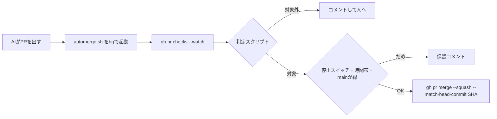

# 小さいPRの自動マージを、決定的なスクリプトで行う（概要と索引）

- 状態: 採用（2026-11-13、Harukiさん承認）。ただし一部は未確定。下の各ADRの `status` と本文を参照
- 日付: 2026-11-13
- 決定者: Haruki。AIは起案者
- このファイルは、全体の概要と索引。決定ごとの詳しい内容は、0005〜0011 に分けて書く

## 目標

AIが出す小さな修正PRを、人が全部読まなくてもマージできるようにする。マージしてよいかは、AIではなく、決定的なスクリプトが決める。人は「判断が必要なこと」と証拠だけを見る。

Harukiさん（2026-11-13 08:52 JST）:「xで＠potetoも言ってたけどAIの出力を信頼できるものにすれば人間は本質的なところの判断だけで良くなるんだよね。目標はそこ。」

## 全体の流れ

マージしてよいかを決めるのは、D と F のスクリプトだけである。

## 決定の索引

| ADR | 決めたこと | 状態 |
|---|---|---|
| [0005](0005-eligibility-decided-by-deterministic-script.md) | 可否は決定的な判定スクリプトが決める（AI判定・fable5.2 は不採用）。ルールの中身、クラスA/B/C、過去40本の結果 | accepted |
| [0006](0006-merge-with-box-gh-and-automerge-sh.md) | マージは box の `gh` と `automerge.sh`（GITHUB_TOKEN・GitHub App・AIが待つ・cron は不採用） | accepted |
| [0007](0007-no-daily-cap-size-limits-weekly-review.md) | 1日の上限なし。大きさは60行・4ファイル・300行で、毎週見直す | accepted |
| [0008](0008-deploy-latest-main-without-cancelling.md) | デプロイは打ち切らず、最新の main を出す。マージはデプロイを待たない | accepted |
| [0009](0009-automerge-safety-guards.md) | 安全装置（停止スイッチ、時間帯、main が赤なら停止ほか） | accepted。人がいる時間は未確定 |
| [0010](0010-pr-template-v2-evidence-first.md) | PRテンプレート v2 の順と、図・証拠の規則 | accepted |
| [0011](0011-automerge-rollout-phases.md) | 進め方（phase 0a → 0b → 1 → 2 → ひな形へ） | accepted。phase 0b 以降は未実施 |

## 未確定・未実施

- 人がいる時間（9:00–22:00 JST のみ）と、最後の push からの待ち時間30分は、初期案で未確定（[0009](0009-automerge-safety-guards.md)）。
- 実際のマージの開始と `AUTOMERGE_ENABLED` の有効化は、Harukiさんの OK の後（[0011](0011-automerge-rollout-phases.md)）。
- #302 はマージ済み、#303 はレビュー中。

## 関連 PR

- [PR #300 PRテンプレート（マージ済み）](https://github.com/H4aruki/MyTechPulse/pull/300)
- [PR #301 gitleaks・ローカルフック・決定Issueテンプレート（マージ済み）](https://github.com/H4aruki/MyTechPulse/pull/301)
- [PR #302 マージの実行役（マージ済み）](https://github.com/H4aruki/MyTechPulse/pull/302)
- [PR #303 判定スクリプトとルール](https://github.com/H4aruki/MyTechPulse/pull/303)
- [PR #304 意思決定ログ](https://github.com/H4aruki/MyTechPulse/pull/304)
- [ai-dev-harness issue #1 意思決定ログ](https://github.com/H4aruki/ai-dev-harness/issues/1)
