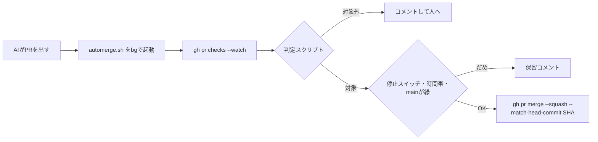

# 小さいPRの自動マージを、決定的なスクリプトで行う

- 状態: 採用（2026-11-13、Harukiさん承認）。#302・#303 はレビュー中
- 日付: 2026-11-13
- 決定者: Haruki。AIは起案者
- 関連:
  - [PR #300 PRテンプレート（マージ済み）](https://github.com/H4aruki/MyTechPulse/pull/300)
  - [PR #303 判定スクリプトとルール](https://github.com/H4aruki/MyTechPulse/pull/303)
  - [PR #302 マージの実行役](https://github.com/H4aruki/MyTechPulse/pull/302)
  - [ai-dev-harness issue #1 意思決定ログ](https://github.com/H4aruki/ai-dev-harness/issues/1)

## 背景

AIが出す小さな修正PRが増え、人が全部を読んでからマージするのが負担になった。一方で、AIに「これはマージしてよい」と判断させると、判断がぶれる。そこで、マージしてよいかは決まりごとだけで決め、人は「判断が必要なこと」と証拠だけを見る形にする。

Harukiさん「AIの判定ではなくスクリプトで判断したい」「1日3回では足りない。無限にやれるようにするべき」。

マージしてよいかを決めるのは、D と F のスクリプトだけ。

## 決定

次の10項目を決めた。各項目の「他の案」と「理由」は表に書く。

| # | 決定 | 他の案 | 理由 |
|---|---|---|---|
| 1 | 可否は決定的な判定スクリプト `scripts/automerge/eligibility.mjs` と、ルールファイル `.github/automerge-rules.json` が決める。AIは判断しない | AIが判断する | 同じ入力なら同じ答えになり、あとから確かめられる |
| 2 | マージは box の `gh` で `scripts/automerge/automerge.sh` が行う。GitHub App は作らない | Actions と `GITHUB_TOKEN`／Actions と GitHub App | `GITHUB_TOKEN` でのマージは、mainのワークフロー（CIとデプロイ）を起動しない仕様（[GitHubの説明](https://docs.github.com/en/actions/concepts/security/github_token)）。App は作成と Secrets 登録の手間がかかる。代償は、マージの記録が本人名になること |
| 3 | CIを待つのはAIではなくシェル。PRを出したら `automerge.sh` をバックグラウンドで起動し、AIはすぐ次へ進む | AIが `gh pr checks --watch` で待つ／box の cron で数分おき | AIが待つと、トークンとClaudeの並列枠を1つ使う。cron より即時。box が落ちて取りこぼすようなら Actions 版へ移す |
| 4 | 1日の本数の上限は設けない | 1日3本 | 3本では足りない（Harukiさん） |
| 5 | 大きさの上限は、テスト以外で60行・4ファイル、合計300行。毎週見直す | 制限なし／200行から始める／2週間ごと | 場所だけでは、中身が大きな機能追加でも通ってしまう。行数が最も簡単な目安 |
| 6 | デプロイは走っているものを打ち切らない。待ち枠は1つで、終わったら最新の main を出す。マージはデプロイの完了を待たない（`blockWhileMainDeployRunning: false`） | 打ち切って最新に切り替える／マージをデプロイ完了まで待たせる | 途中で止めると中途半端な状態が残る。間のマージは最新 main に入るので抜けない。`ci.yml` で main は `cancel-in-progress` しない設定を確認済み |
| 7 | 停止スイッチ `AUTOMERGE_ENABLED`（既定オフ。オフならコメントだけ）。記事取得（5:30〜6:20、11:00〜11:50、16:00〜16:50 JST）とバックアップ（3:50〜4:20 JST）の前後はマージしない。main が赤なら止まる | — | すぐ全部止められるように。反映でAPIが入れ替わると記事取得が途中で切れる。壊れた main に重ねない。オンにするのはHarukiさんの許可の後 |
| 8 | マージ直前に毎回ゼロから判定し直し、判定したコミットだけを `--match-head-commit` でマージする。判定は main にある版のスクリプトで動かす | ラベルで判定結果を持つ | 判定後のコミット追加や、PR内での判定スクリプトの書き換えを防ぐ |
| 9 | PRテンプレートの順は、一行で → なぜ → 理解しておいてほしい1点 → 確かめたこと → 判断が必要なこと → 見てほしい場所。「判断が必要なこと」が「なし」以外なら自動マージしない | 「判断が必要なこと」を先頭に | 証拠を見たあとで判断するため（Harukiさん指定） |
| 10 | 図と証拠を先に置く。挙動は mermaid、状態は状態図、画面は before / after のスクショ、操作は短い動画。図の直後に1文を書く。動く部分が3つ以上なら図を分ける。無いときは「なし」と理由を書く | 文章中心 | 人が頭の中で組み立てる負担を減らす |

自動マージの対象は `server/internal/**` と `frontend/src/**` だけ。DB・認証・起動・本番・依存・`.github`・`.claude`・判定ルール自体・削除や改名は対象外。テストの追加か変更が必須で、テストの削除やskipは対象外。CIが全部成功・mainに追従・ドラフトでない・`no-automerge` ラベルなし・未解決のスレッドなし、も条件にする。

## 理由（判断基準）

1. 決められることはスクリプトで決め、AIは曖昧な部分だけを担当する。
2. 戻せない変更と、ルールを自分で緩めるPRは、自動で通さない。
3. 人の判断は、「判断が必要なこと」と証拠の確認に絞る。
4. 検証の仕組みより先に、自動化を広げない。

根拠は @poteto（Lauren Tan）の次の原則。

| 原則 | 出典 |
|---|---|
| レビューの中心は差分全文ではなく検証の成果物（動画・スクショ・図・形式検証）。成果物は正しく、意図どおりで、PR全体を読むよりレビューしやすいこと | AI Engineer Code Summit 2026-11-11「All Code Is Slop (Except Mine)」 https://agents.conffab.com/aie-code-26/live/keynotes/sessions/1794420600.md ／ https://x.com/poteto/status/2109436202554372476 ／ https://x.com/poteto/status/2107529532144234937 |
| 「直した」では足りない。直す前に落ちるテストと通るテスト、before/after を見せる | 「Loops You Can Trust」 https://x.com/poteto/status/2069824386283319343 ／ https://x.com/poteto/article/2094457600259842065 |
| 決められることはスクリプトで決める。エージェントは曖昧な部分だけ | 同上 ／ https://x.com/poteto/status/2111133080526495985 |
| 土台が良ければ、リスクの低いPRは深い人間レビュー無しでマージしてよい | https://x.com/poteto/status/2108283057581195413 ／ https://x.com/poteto/status/2087244771849089270 |
| 状態図はスクショや動画と並べてレビューしやすい | https://x.com/poteto/status/2112736749281759566 ／ https://x.com/poteto/status/2113398433977659654 |
| コードを読むだけのAI同士のレビューを自動マージの条件にしない | https://x.com/poteto/status/2117437607940681849 ／ https://x.com/poteto/status/2117440753551204735 |
| 悪いループを自動化しない（slop が増えるだけ） | 同講演「don't automate a bad loop」 |

## 影響

- マージの記録は Harukiさん本人の名前になる（App を使わないため）。作成者はAIも人も同じ `H4aruki` なので、作成者では信頼を決めない。
- マージのたびに本番へ自動で反映される。待ちは長くても「今の1回＋最新の1回」。
- 判定ルールの変更は、自動マージの対象外。人がレビューする。

## リスクと対策

| リスク | 対策 |
|---|---|
| 判定の線引きが合わない | 最初は過去40本のマージ済みPRで試し、毎週見直す |
| box が落ちて取りこぼす | 取りこぼしは人がマージする。多いようなら Actions 版へ移す |
| 暴走する | `AUTOMERGE_ENABLED` を切る。`no-automerge` ラベルで1本ずつ止められる |

## 進め方

1. 過去40本のマージ済みPRに、判定スクリプトを手元でかける（読むだけ。リポジトリは変えない）。
2. 判定結果のコメントだけを付ける（`AUTOMERGE_ENABLED` はオフのまま）。
3. 範囲を狭くして有効化する（Harukiさんの許可が要る）。
4. 問題がなければ広げる。

## 未決事項・見直す条件

- 大きさの上限は、毎週見直す。
- #302・#303 のレビューが終わるまで、実際のマージは始めない。
