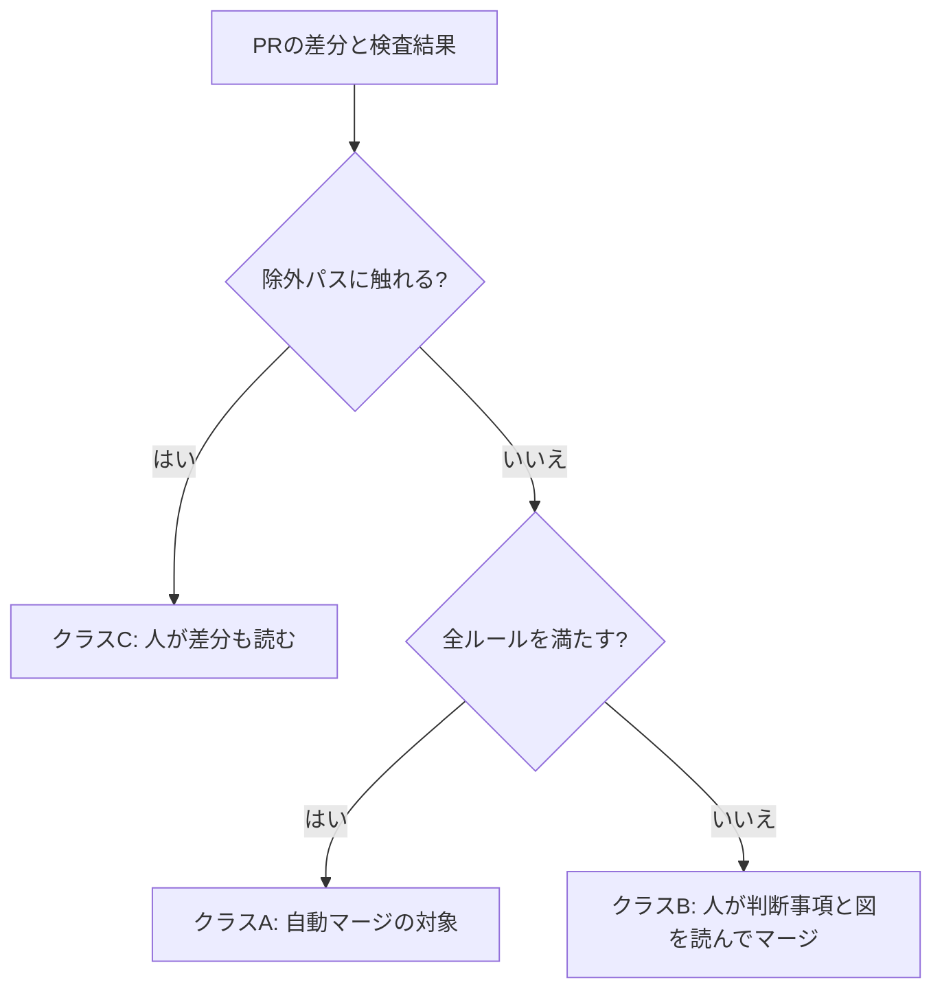

# 自動マージの可否は、決定的な判定スクリプトが決める

- 状態: 採用（2026-11-13）。判定スクリプトの実装は [PR #303](https://github.com/H4aruki/MyTechPulse/pull/303) でマージ済み（2026-11-13 16:51 JST、f4125a2）
- 日付: 2026-11-13
- 決定者: Haruki。AIは起案者
- 全体の概要: [0004](0004-automerge-small-prs-by-deterministic-script.md)

## 背景と問題

AIが出す小さな修正PRが増え、人がPRを理解してマージするまでの時間が大きなボトルネックになっていた。人が全部を読むのをやめるには、「このPRはマージしてよいか」を誰かが代わりに決める必要がある。AIに決めさせると、同じPRでも判断がぶれ、あとから確かめられない。

直近40本のPRの作成者は、全部 `H4aruki` だった（ボットもHarukiさんの `gh` で出している）。作成者ではAIか人か見分けられないので、作成者で信頼を決められない。

## 検討した案

| 案 | 内容 | 採否 | 採らなかった理由（採用なら採った理由） |
|---|---|---|---|
| A | ルールファイルの数字と一覧を、決定的なスクリプトが読んで決める | 採用 | 同じ入力なら同じ答えになり、あとから確かめられる。Harukiさんの方針とも合う |
| B | AIが差分を読んで「マージしてよい」と判断する | 不採用 | 判断がぶれる。Harukiさんが「AIの判定ではなくスクリプトで判断したい」と指定した |
| C | Claude の fable5.2 に判定の設計を決めさせる | 不採用 | 設計が問題なく進んだので使わなかった。fable はトークンを大量に使うため、他のモデルで代用できるところは代用する方針だった |
| D | AI同士のコードを読むだけのレビューを、自動マージの条件にする | 不採用（止める側としてだけ使える） | poteto が、コードを走らせず読むだけのAI同士のレビューには価値が薄いと指摘している。通す理由にはしない |
| E | 作成者（AIか人か）で信頼を決める | 不採用 | 直近40本が全部 `H4aruki` で、区別できない |

## 決定

可否は、決定的な判定スクリプト `scripts/automerge/eligibility.mjs`（Node標準だけ。入力はGitHub APIのJSONだけ）と、ルールファイル `.github/automerge-rules.json`（しきい値・パスの一覧・有効/無効）が決める。AIは判断しない。PRのコードは動かさず、APIで得た差分と検査結果だけを見る。

### ルールの中身

| 区分 | 内容 |
|---|---|
| 許可パス | `server/internal/**`、`frontend/src/**`（どちらも下の除外以外）、各テストファイル、`testdata/**` |
| 除外（ひとつでも触れたら対象外） | DB（`server/db/**`、`server/openapi/**` など）、認証・安全（パスに `auth` `passkey` `webauthn` `session` `csrf` `ratelimit` `security` を含むもの、`server/internal/platform/{config,httpx}/**`）、起動・組み立て（`server/cmd/**`、`server/internal/app/**`）、本番・インフラ（`ops/**`、`Caddyfile`、`docker-compose.yml`、`**/Dockerfile`、`scripts/**`）、依存（lockfile）、仕組みそのもの（`.github/**`、`.claude/**`、`.codex/**`、`.agents/**`、`AGENTS.md`、`CLAUDE.md`、`scripts/automerge/**`）、その他（`.env*`、`*.pem`、`*.key`、バイナリ、ファイル名の変更・削除、シンボリックリンク） |
| テスト必須 | テストの追加か変更が必要。テストファイルの削除は対象外。テストの削除行は追加行以下。追加行に `t.Skip(` `.skip(` `.only(` `@ts-ignore` `eslint-disable` `//nolint` `exec.Command` `dangerouslySetInnerHTML` があれば対象外 |
| 状態 | 先頭コミットで必須検査5つが成功し、ほかの検査にも失敗・取り消しが0で、走っている検査が0。最新の main に追従済み。ドラフトでない。base が main。同じリポジトリのブランチ。`no-automerge` ラベルが無い。「変更を求める」レビューと未解決スレッドが0 |
| 本文 | PRテンプレートの「判断が必要なこと」が「なし」。AIが判断を残したPRは人へ回す |

大きさの数字は [0007](0007-no-daily-cap-size-limits-weekly-review.md) に書く。

### 3つのクラス

判定は、除外パスならC、全ルールを満たせばA、許可パスだが大きさなどで外れたらB、の3つに分かれる。

### ルールを触るPRは対象外

`.github/**` と `scripts/automerge/**` を触るPRは、必ず対象外にする。CODEOWNERS はあるが、ルールセットでコードオーナーの承認を必須にしていないので、守れない。ルールを自分で緩めるPRを通さないための決定である。

### go.mod にある依存の扱い（実装中の変更）

最初の試し（コミット 050fd23）では、Goの外部 import の判定が、すでに使っている依存（pgx・goose）まで弾いた。#272、#288 などが落ちた。そこで、`go.mod` にある依存は許す形に変えた。依存を新しく足すPRは、lockfile を触るので、除外パスの規則で対象外のままである。この変更は #303 の「判断が必要なこと」で確認したものである（#303 はマージ済み）。

## 本人の発言

- 2026-11-13 08:52 JST（設計の依頼、Rex との会話）:「…正なのかというのを判断するのかが問題。ここはAIの判定ではなくスクリプトで判断したい。それからここの中にもあったと思うけどPRを人間が理解してマージするまでの時間が今かなりボトルネックになってるからそれを解消するためのPRテンプレートになってる。xで＠potetoも言ってたけどAIの出力を信頼できるものにすれば人間は本質的なところの判断だけで良くなるんだよね。目標はそこ。難しそうだったらfable5.2に決めさせて実装は別のモデルにやらせる方針でもいいよ。fableトークンめっちゃ使うから他のモデルで代用できるところは他のモデル使うようにして。grokでコーディングでも良い」
- 2026-11-13 午後（時刻の記録なし）:「今回の設計をする時にclaudeのfable5.2を使ってもいいよという話だった。問題なくやれてそうなら使わなくて良い。それから自動マージは1日3回では足りない。無限にやれるようにするべき。マージ自体はAIがやってもいいんだけどマージするかしないかの判断をスクリプトで制御したいという話。」

## 理由（判断基準）

1. 同じ入力なら同じ答えになること（再現できて、あとから確かめられる）。
2. 戻せない変更・約束が変わる変更・ルール自体を緩める変更を、機械的に通さないこと。
3. 人は「判断が必要なこと」と証拠だけを見ればよい形にすること（poteto の原則: 決められることはスクリプトで決める。エージェントは曖昧な部分だけ）。

## 根拠のデータ・事実

過去のマージ済みPR 40本に判定をかけた（2026-11-13 16:13 JST、コミット 5761519、取得失敗0）。

| 項目 | 結果 |
|---|---|
| クラス別 | A 0 / B 6 / C 34 |
| 本文ルール（判断が必要なこと）を除いたとき | 対象になるのは5本（#293 #292 #290 #289 #287） |
| よく当たったルール | body.decision 40、path.excluded 22、path.not-allowed 22、size.nonTestLines 19、tests.missing 15、checks.required-missing 11、size.nonTestFiles 11、size.totalLines 9 |

過去のPRは、新しいテンプレート（[0010](0010-pr-template-v2-evidence-first.md)）が無い時代のものなので、本文ルールで全部が外れた。ルールセット `main` の現状は、`gh api repos/H4aruki/MyTechPulse/rules/branches/main` で確認した（deletion、non_fast_forward、pull_request、required_status_checks。承認0、bypass なし）。

## 結果と代償

- 良くなること: 判定が再現でき、ルールを変えるPRは人がレビューする。
- 代償: 行数やパスの機械的な線引きは、中身の良し悪しを見ない。線引きが合わないと、対象にしてよいPRが人に回る（安全側に倒れる）。
- 残るリスク: 過去40本では A が0本だった。本文ルールを除いても5本しか対象にならず、最初は自動マージが少ない。これは、狭く始めて広げる方針（[0011](0011-automerge-rollout-phases.md)）の想定どおりである。

## 見直し方

- いつ: 自動マージが動き出してから毎週（[0007](0007-no-daily-cap-size-limits-weekly-review.md)）。
- 何を見て: クラスB・Cに回った理由の内訳、戻した本数、Harukiさんの感覚とのずれ。
- 誰が: AIが表にして提案し、ルールを変えるPRは人がマージする。

## 関連リンク

- [PR #303 判定スクリプトとルール](https://github.com/H4aruki/MyTechPulse/pull/303)
- [ai-dev-harness issue #1 意思決定ログ](https://github.com/H4aruki/ai-dev-harness/issues/1)
- poteto: 決められることはスクリプトで決める https://x.com/poteto/status/2111133080526495985 ／ コードを読むだけのAI同士のレビューを条件にしない https://x.com/poteto/status/2117437607940681849
- 設計書（リポジトリ外）: `/workspace/mtp-automerge-design/design.md` の1章
