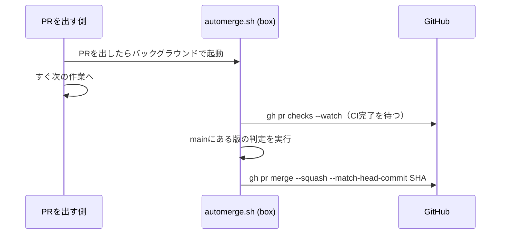

# マージは box の gh と automerge.sh で行う

- 状態: 採用（2026-11-13）。実装は [PR #302](https://github.com/H4aruki/MyTechPulse/pull/302)（マージ済み、2026-11-13 16:39 JST）
- 日付: 2026-11-13
- 決定者: Haruki。AIは起案者
- 全体の概要: [0004](0004-automerge-small-prs-by-deterministic-script.md)

## 背景と問題

判定（[0005](0005-eligibility-decided-by-deterministic-script.md)）でマージしてよいと決まったPRを、誰が、どの権限で、いつ、マージするかを決める必要がある。マージはmainのCIとデプロイを起こすので、起動する仕組みの選び方が重要である。待ち方によっては、トークンやClaudeの並列枠も使う。

## 検討した案

| 案 | 内容 | 採否 | 採らなかった理由（採用なら採った理由） |
|---|---|---|---|
| A | box の `gh`（Harukiさんのログイン）で、シェルの `automerge.sh <PR>` がCI待ち・判定・マージまでやる | 採用 | 今のログインだけで済み、mainのCIとデプロイがいつもどおり走る |
| B | GitHub Actions が `GITHUB_TOKEN` でマージする | 不採用 | `GITHUB_TOKEN` によるマージでは、mainのワークフロー（CIとデプロイ）が起動しない。GitHubが再帰を防ぐ仕様である（https://docs.github.com/en/actions/concepts/security/github_token ） |
| C | GitHub App を作って Actions でマージする | 不採用 | App の作成と Secrets 登録の手間がかかる。box の `gh` で足りる。box が落ちて取りこぼすようなら、将来 Actions 版へ移す |
| D | PRを出したボット（AI）が `gh pr checks --watch` でCIを待つ | 不採用 | トークンの利用が増え、待ちのためにClaudeの並列数を1つ使い、効率が落ちる（Harukiさんの指摘） |
| E | box の cron で数分おきにPRを拾う | 不採用（予備として後から足してよい） | 即時性で劣る |

## 決定

- マージは、box の `gh` を使って `scripts/automerge/automerge.sh <PR番号>` が行う。GitHub App は作らない。
- 待つのはAIではなくシェルスクリプト。PRを出したら、バックグラウンドで `automerge.sh` を起動し、AIはすぐ次の作業へ進む。出す側が必ず呼ぶ。出し忘れに備えた cron は、必要になってから足す。
- マージの直前に、毎回ゼロから判定し直す。前回の「OK」は使わない。判定した先頭コミットだけを `gh pr merge --squash --match-head-commit <SHA>` でマージする。コミットが足されていれば失敗する。
- 判定スクリプトは、PRのブランチのものではなく、`main` にある版を使う。
- リポジトリ全体で `flock` を1つ持ち、マージは同時に1本だけにする。
- `.claude` のガードは今のまま。AIが会話の中で `gh pr merge` するのは、引き続き止める。`automerge.sh` はClaudeを通さずシェルで動く。

AIは起動したら待たず、待ちとマージはシェルだけが行う。

## 本人の発言

- 2026-11-13（時刻の記録なし、GITHUB_TOKEN の説明のあと）:「それならghコマンドでいいよ」
- 2026-11-13（時刻の記録なし）:「prが出されたタイミングで自動マージかどうかの判定スクリプトが動けばいいだけじゃない？ 自動マージ可能ならそのままスクリプトでgrok botのターミナルでghコマンド打つように制御すれば全自動でしょ？」
- 2026-11-13（時刻の記録なし、PRを出したボットが gh pr checks --watch で待つ案に対して）:「1はそれでいい。2はそれだとトークン利用が増えるのと待ちのために並列数を１つ使うことになるから効率が落ちる。トークンのほうならうまくいくならトークンのほうでもいいけどどう？」
- 2026-11-13（時刻の記録なし、シェルスクリプトがバックグラウンドで待つ案に対して）:「ghの案で行こう。その形式で問題なさそう」
- 2026-11-13 午後（時刻の記録なし）:「マージ自体はAIがやってもいいんだけどマージするかしないかの判断をスクリプトで制御したいという話。」

## 理由（判断基準）

1. mainへのマージで、CIとデプロイが今までどおり起動すること。
2. 新しい仕組み（App、Secrets）を増やさず、今のログインで足りること。
3. AIのトークンと並列枠を、待ちに使わないこと。
4. 判定した内容と、マージされる内容が一致すること（`--match-head-commit`、`main` の版のスクリプト）。

## 根拠のデータ・事実

- GitHubの仕様: `GITHUB_TOKEN` で起こしたイベントは、`workflow_dispatch` などを除き、新しいワークフローを起こさない（出典: 上のURL）。
- GitHub から box のターミナルを直接呼ぶ手段は無いので、起動の起点は「PRを出した側」になる。
- Codex のレビューで見つかり直したもの（判定スクリプトが main に無いとき、`--rules` の受け渡し）は [0009](0009-automerge-safety-guards.md) に書く。
- 実装とテスト: `scripts/automerge/automerge.sh`、`scripts/automerge/automerge_test.sh`、`docs/automerge-runner.md`。

## 結果と代償

- 代償: マージの記録が、Harukiさん本人の名前になる。自動と手動を分けるには、`automerged` ラベルとスクリプトのコメントを使う。
- 残るリスク: box が落ちると取りこぼす。取りこぼしは人がマージする。多いようなら Actions 版へ移す。
- 出し忘れると、そのPRは自動マージされない（安全側。人がマージする）。

## 見直し方

- いつ: 取りこぼしが週次の見直しで目立ったとき。
- 何を見て: 自動マージされなかったPRのうち、対象だったものの数。box のログ（`/home/box/shared/bot-logs/`）。
- 誰が: AIが提案し、Harukiさんが決める。Actions 版へ移すなら新しいADRで置き換える。

## 関連リンク

- #302 の後に見つかった2件（`--rules` の受け渡し、main の保護の確認）は、[PR #305](https://github.com/H4aruki/MyTechPulse/pull/305)（レビュー中）で入る。

- [PR #302 マージの実行役](https://github.com/H4aruki/MyTechPulse/pull/302)
- [docs/automerge-runner.md](../automerge-runner.md)
- GitHub: https://docs.github.com/en/actions/concepts/security/github_token
- [ai-dev-harness issue #1](https://github.com/H4aruki/ai-dev-harness/issues/1)
