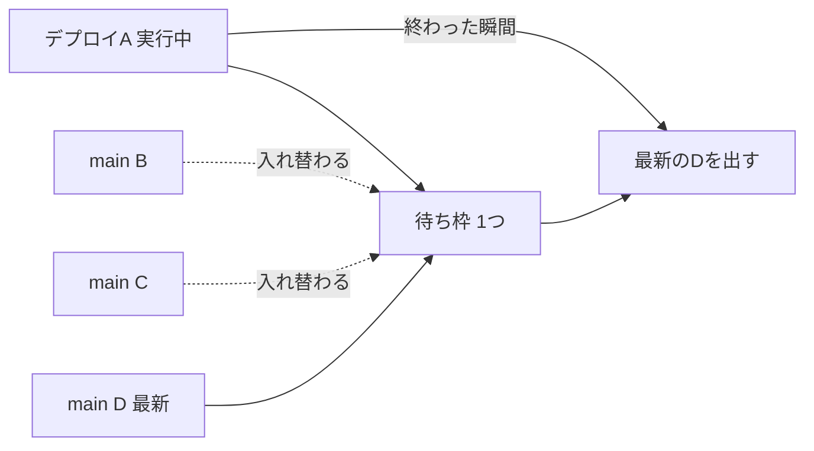

# デプロイは打ち切らず、最新の main を出す

- 状態: 採用（2026-11-13）。`ci.yml` はすでにこの設定だったので、ワークフローの変更は不要だった。デプロイを速くする候補は未実施
- 日付: 2026-11-13
- 決定者: Haruki。AIは起案者
- 全体の概要: [0004](0004-automerge-small-prs-by-deterministic-script.md)

## 背景と問題

マージが増えると、デプロイ中に次のマージが来る。Harukiさんの疑問は、デプロイ中にマージするとデプロイが止まるのではないか、ということだった。また、デプロイ待ちの時間もボトルネックなので、なるべく短くしたい。

## 検討した案

| 案 | 内容 | 採否 | 採らなかった理由（採用なら採った理由） |
|---|---|---|---|
| A | 走っているデプロイは打ち切らない（`cancel-in-progress: false`）。待ち枠は1つで、終わった瞬間に待っている中の最新 main を出す | 採用 | 途中で止めない。間のマージは最新 main に全部入っているので、抜けない |
| B | 走っているデプロイを打ち切って、最新に切り替える（`cancel-in-progress: true`） | 不採用 | 中途半端な状態が残る |
| C | マージを、デプロイの完了まで待たせる | 不採用 | デプロイ待ちがボトルネックになる（Harukiさん） |

## 決定

- デプロイは、走っているものを打ち切らない。
- 待ち枠は1つ。新しい main が来るたびに、待っている実行は最新に入れ替わる。A のデプロイ中に B、C、D がマージされても、A のあとに出るのは、その時点の最新 main（B〜D が全部入っている）の1回だけ。待ちは長くても「今の1回＋最新の1回」。
- マージは、デプロイの完了を待たない。走っているデプロイがあっても、マージはしてよい。

B・C は待ち枠から落ちるが、D にその変更が全部入っているので、抜けは無い。

## 本人の発言

- 2026-11-13（時刻の記録なし）:「デプロイ中にマージするとデプロイが止まる問題何とかならない？」
- 2026-11-13（時刻の記録なし）:「B.Cを待ってる間にd,e,f,.....と続いても最新のやつがマージされるようになる？ デプロイ待ちの時間もかなりボトルネックだからなるべく短くしたい」
- 2026-11-13（時刻の記録なし）:「デプロイが終わった瞬間の一番新しいデプロイ待ちの最新マージをデプロイするってことね」

## 理由（判断基準）

1. デプロイを途中で止めて、本番を中途半端な状態にしないこと。
2. マージの流れを、デプロイ待ちで止めないこと。
3. 抜けなく、最新の main が必ず出ること。

## 根拠のデータ・事実

`gh` で読み取った（2026-11-13、Rex）。

- `ci.yml` の concurrency: ワークフロー全体は `cancel-in-progress: ${{ github.ref != 'refs/heads/main' }}`（main は打ち切らない）。`go-deploy` は `group: go-deploy`、`cancel-in-progress: false`。`release.yml` も false。MyTechPulse は確認の結果、すでにこの設定だった。
- 待ち枠は1つで、新しい main が来ると、待っている実行が入れ替わる。10/24・10/25 の3件の cancelled は、この入れ替わりである。
- main への push からデプロイ完了までは、直近の成功10回で約5.2〜6.2分（312〜374秒）。
- 内訳（#297 の例）:

| 段階 | 時間 | 備考 |
|---|---|---|
| Goバックエンドの検査 | 約134秒 | テストとbuildの工程の中央値は121秒 |
| 配布物の作成 | 約150秒 | 検査が全部終わるまで始まらない。image の build と push が約49秒、frontend の build が約39秒 |
| 本番への反映 | 約50秒 | Cloudflare Pages の公開が17秒、サーバーでの入れ替えが12秒 |

### 速くする候補（未実施）

- 配布物のビルドを検査と並行に始め、反映だけゲートする（約2分短縮の見込み）。
- image 検査で作った image を再利用する（約50秒）。
- Goのテストのキャッシュや分割。

## 結果と代償

- 良くなること: デプロイが止まらず、最新の main が必ず出る。
- 代償: マージから反映まで、最悪で「今の1回＋最新の1回」ぶん、約6分を2回待つ。
- 残るリスク: 待ち枠に入れ替わった途中の main は、単独では本番に出ない（最新に含まれる）。途中のコミットだけの状態を本番で確認したいときはできない。

## 見直し方

- いつ: デプロイ待ちが目立つとき。または、速くする候補を実施するとき。
- 何を見て: main への push からデプロイ完了までの所要時間（直近の成功10回など）。
- 誰が: AIが別PRで提案し、人がレビューする。

## 関連リンク

- [0004 概要](0004-automerge-small-prs-by-deterministic-script.md)
- `.github/workflows/ci.yml`
- [デプロイの手順書](../deploy/go-auto-deploy.md)
