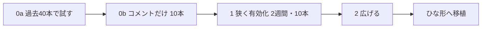

# 自動マージは段階を踏んで始める

- 状態: 採用（2026-11-13）。phase 0a は実施済み。phase 0b 以降と、ひな形への移植は**未実施（proposed）**
- 日付: 2026-11-13
- 決定者: Haruki。AIは起案者
- 全体の概要: [0004](0004-automerge-small-prs-by-deterministic-script.md)

## 背景と問題

判定の線引きが現実のPRに合うかは、やってみないと分からない。検証の仕組みより先に自動化を広げると、質の悪いループが速く回るだけになる。そこで、読むだけの試しから始め、段階ごとに終わる条件と必要な OK を決める。

## 検討した案

| 案 | 内容 | 採否 | 採らなかった理由（採用なら採った理由） |
|---|---|---|---|
| A | 過去で試す → コメントだけ → 狭く有効化 → 広げる | 採用 | 検証の仕組みより先に自動化を広げない |
| B | いきなり有効化する | 不採用 | 線引きが合うか未確認のまま本番に重ねてしまう |

## 決定

| 段階 | やること | 終わる条件 | Harukiさんの OK |
|---|---|---|---|
| phase 0a 過去で試す | 判定スクリプトを直近40本のマージ済みPRに手元でかけ、A/B/C の分かれ方を表にする（リポジトリは変えない） | Harukiさんが「この線引きでいい」と言う | 不要（読み取りだけ） |
| phase 0b テンプレートと判定コメント | 新テンプレートと、コメントだけの判定（マージしない）を MyTechPulse のPRにする。デプロイ concurrency の確認も同じか別のPRで | 10本のPRで、判定と Harukiさんの感覚がずれない（ずれたらルールを直す） | このPRのマージ（いつもどおり） |
| phase 1 狭く有効化 | box に `automerge.sh` を置き、`AUTOMERGE_ENABLED=true`。対象は「テストつきの `server/internal/**`・`frontend/src/**` の小さい修正」だけ | 2週間・自動マージ10本で、戻し0 | **停止スイッチの設置と有効化**（マージを本当に始める許可） |
| phase 2 広げる | 「直す前に落ちるテスト」の証拠をCIで確かめる、gitleaks、カバレッジが下がらないこと、を条件に足す。そのうえで行数のしきい値や docs を広げるか決める | 条件なし（ルールを広げるたびに判断） | ルールを広げるたび。設定ファイルの変更PRは常に人がマージ |
| ひな形へ移植 | 判定スクリプト、`automerge.sh`、テンプレート、意思決定ログを `H4aruki/ai-dev-harness` のIssueとPRに入れる | レビューとマージはHarukiさん | PRの作成まではいつもの許可の範囲。マージは人 |

左から右へ進み、各段階の終わる条件を満たしてから次へ進む。

実際の自動マージの開始と、変数の有効化は、Harukiさんの OK が要る。リポジトリ設定・Secrets・App は、この案では不要である。

## 本人の発言

- 2026-11-13（時刻の記録なし）:「一旦この案で行こう。@potetoが言っていることは本質をとらえている重要事項なのでしっかり反映させてほしい」
- 2026-11-13（時刻の記録なし）:「自動マージのやつ多分misoが作ったひな形のリポジトリのほうにはない気がするから入れておいてほしいかな。意思決定のログも含めてPRとissue出してもらえればいい。」
- 段階の名前、10本・2週間・10本の数字について: 記録なし（設計書の提案を、上の「この案で行こう」で採用した）

## 理由（判断基準）

1. 検証の仕組みより先に、自動化を広げないこと（poteto の「don't automate a bad loop」）。
2. 本番に影響する段階の前に、必ず人の OK を挟むこと。
3. 各段階で、戻れる（止められる）こと。

## 根拠のデータ・事実

- phase 0a は実施済み（2026-11-13 16:13 JST、コミット 5761519、取得失敗0）。結果は A 0 / B 6 / C 34。詳しくは [0005](0005-eligibility-decided-by-deterministic-script.md)。
- 実装のPR: #300 テンプレート v2（マージ済み）、#301 gitleaks・githooks・決定Issueテンプレート（マージ済み）、#302 `automerge.sh`（マージ済み、2026-11-13 16:39 JST）、#303 判定スクリプト（マージ済み、2026-11-13 16:51 JST、f4125a2）、#304 このADR。
- ai-dev-harness は issue #1（意思決定ログ）と PR #2（雛形）。

## 結果と代償

- 良くなること: 線引きの誤りを、本番に影響が出る前に見つけられる。
- 代償: 自動マージが本格的に動くまでに時間がかかる。最初の数週間は、人がマージする本数があまり減らない。
- 残るリスク: 10本・2週間という数字は、設計書の初期案であり、実際には調整が要る。

## 見直し方

- いつ: 各段階の終わる条件を満たしたとき。
- 何を見て: 判定と Harukiさんの感覚のずれ、戻した本数。
- 誰が: AIが結果を報告し、Harukiさんが次の段階へ進むかを決める。

## 関連リンク

- [0004 概要](0004-automerge-small-prs-by-deterministic-script.md)
- [PR #303](https://github.com/H4aruki/MyTechPulse/pull/303)、[PR #304](https://github.com/H4aruki/MyTechPulse/pull/304)
- [ai-dev-harness issue #1](https://github.com/H4aruki/ai-dev-harness/issues/1)
