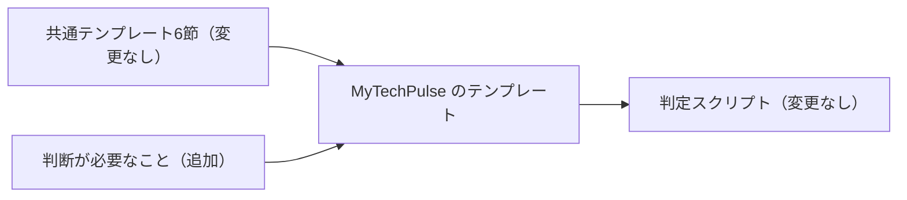

# PRテンプレートを短いブリーフィング形式にし、判断欄を残す

- 状態: 採用。[0010](0010-pr-template-v2-evidence-first.md)（以前の型。証拠と図を先に見せる形）を置き換える
- 日付: 2026-11-13
- 決定者: Haruki。AIは起案者
- 全体の概要: [0004](0004-automerge-small-prs-by-deterministic-script.md)

## 背景と問題

- これまでのPRテンプレートは、以前の型（証拠と図を先に見せる形。[PR #300](https://github.com/H4aruki/MyTechPulse/pull/300)、[ADR 0010](0010-pr-template-v2-evidence-first.md)）だった。
- そのあと、poteto の opening-a-pr の日本語訳を、複数のリポジトリで使う共通テンプレートにする話が出た（出典: `/home/box/shared/pr-template/pull_request_template.ja.md`）。この形は、1分で読めるブリーフィングで、約40行以内に収める。6節は「なぜ / 何を変えたか / 範囲 / トレードオフ / 影響範囲 / 確認」。
- MyTechPulse には、自動マージの判定が見る「判断が必要なこと」の節がある。共通テンプレートにはこの節が無い。どう合わせるかを決める必要があった。
- 起案したAIが3つの選択肢を出し、Harukiさんが1つ選んだ（次の表）。会話の中では「案A・案B・案C」と呼ばれていたが、この文書では中身で書く。

## 検討した案

| 選択肢（会話での呼び名） | 内容 | 採否 | 採らなかった理由（採用なら採った理由） |
|---|---|---|---|
| 共通テンプレートに判断欄だけ足す（案A） | 共通テンプレートの6節はそのまま使い、末尾に「判断が必要なこと」だけ足す。判定ロジックは変えない | 採用 | 6節を一字も変えずに共通化でき、判定の鍵は今まで通り判断欄に残るため |
| 判定が見る節を付け替える（案B） | 共通テンプレートを純粋な翻訳のままにして、判定が見る節を既存の6節のどれかに付け替える | 不採用 | 判定ロジックと既存のテスト・運用を変える必要があり、自動マージの安全装置の変更が大きくなるため |
| MyTechPulse は以前の型のままにする（案C） | MyTechPulse は以前の型（証拠と図を先に見せる形）を使い続け、新しい形は ai-dev-harness だけに入れる | 不採用 | 2つのリポジトリのテンプレートが分かれたままになり、共通化の目的に合わないため |

Harukiさんは「今作ったテンプレに判断が必要なことをついかするだけでいい。」と述べた（2026-11-13 17:31 JST）。これで、6節を書き換えるのではなく、末尾に1節を追加するだけにすると確定した。

6節は共通テンプレートのまま、判断欄だけを足し、判定スクリプトは変えないことを示す。

## 決定

- `.github/pull_request_template.md` を、共通テンプレートの6節（なぜ / 何を変えたか / 範囲 / トレードオフ / 影響範囲 / 確認）と末尾の2つのHTMLコメントをそのまま使う形に置き換える。
- そのあとに `## 判断が必要なこと` を1節だけ足す。無いときは本文を `なし` とだけ書く。「なし」以外は自動マージ対象外。
- 判定ロジック（`scripts/automerge/eligibility-core.mjs`）は変更しない。
- 案内（`docs/pr-template.md`、`CONTRIBUTING.md`）と判定テストの見出しを、新しい節に合わせる。
- 以前の型を決めた ADR 0010 の `status` を `superseded` にし、置き換え先をこの ADR にする。
- 決めた人はHarukiさん。2026-11-13 から。MyTechPulse のPR本文すべてに適用する。
- 新しい規則: PR と Issue の本文は、判断に関わっていない開発者でも理解できるように書く。「案A」のような内側だけの呼び方で済ませず、各選択肢の中身と、採らなかった理由を本文で説明する。この規則は、今後のすべての PR と Issue に適用する（2026-11-13 17:42 JST の指摘による）。

## 本人の発言

発言は、会話を取り次いだ親エージェント経由のものと、PR へのコメントとして直接書かれたものがある。原文のまま引用し、直していない。

1. 2026-11-13 17:23 JST、会話を取り次いだ親エージェント経由。新しいPRテンプレート案への承認: 「LGTM」。これより長い原文は、リポジトリにも指示にも無い。
2. 2026-11-13 17:30 JST、Harukiさん本人（チャット上の発言）。共通テンプレートに判断欄だけ足す選択肢（当時の呼び名は「案A」）を選んだ発言: 「それならok.」
3. 2026-11-13 17:31 JST、親エージェント経由の本人の言葉: 「今作ったテンプレに判断が必要なことをついかするだけでいい。」（「ついか」は「追加」の誤変換の可能性があるが、引用では直していない）
4. 2026-11-13 17:42 JST、Harukiさん本人（MyTechPulse PR #306 へのコメント）: 「トレードオフのところ、判断した人が見る前提で作られてる。ほかの開発者が見たときでも理解できるようにするべき。これはissueでもほかのprでも同じことが言える」

## 理由（判断基準）

1. いちばん重い基準: 自動マージの安全装置（判断欄を鍵にした判定）を変えないこと。
2. 共通テンプレートの6節を一字も変えず、他リポジトリと同じ形で書けること。
3. レビュワーが1分で読める短さにすること。
4. 判断に関わっていない開発者も、本文だけで読めること（上の発言4）。

## 根拠のデータ・事実

- 出典: `/home/box/shared/pr-template/pull_request_template.ja.md`（6節と末尾の2つのHTMLコメント）。
- 現在の判定は、`decisionSection`、見出し「判断が必要なこと」、本文が「なし」だけかを見る（`scripts/automerge/eligibility-core.mjs`、[docs/automerge.md](../automerge.md)）。見出しが無い、または「なし」以外なら `body.decision` で対象外になる。
- 以前の型を入れた [PR #300](https://github.com/H4aruki/MyTechPulse/pull/300) と、ADR の書き方を足した [PR #304](https://github.com/H4aruki/MyTechPulse/pull/304) は、すでにマージ済み（2026-11-13、`git log` で確認）。
- 判定テストの確認結果は、このPRの本文の「確認」に書く。

## 結果と代償

- テンプレートは短く、レビュー向けのブリーフィングになる。
- 以前の型で必須だった図・テスト表は任意寄りになる。証拠（動画、スクリーンショット、構成図、UML）は、主張を支えるときだけ付ける。
- 判定の鍵はこれまで通り判断欄なので、自動マージの安全装置は維持される。
- 残る緊張: 共通テンプレートの出典コメントは「書くことがない節は消す」と言うが、判断欄は必須で消せない。出典コメントは変えず、判断欄のコメントに「必須」と書いて示す。消すと `body.decision` で対象外になるだけで、安全側に倒れる。
- 代償: 選択肢の中身と理由を毎回書くので、トレードオフ節と判断欄は少し長くなる。約40行の目安の中で収める。

## 見直し方

- 自動マージ phase 0b の10本を見るときと、毎週の大きさの見直しのとき、Harukiさんが見る。
- 見る点: 本文が読みやすいか、「なし」の使い方（「なし」に寄せていないか）がずれていないか、判断に関わっていない人にも通じる書き方になっているか。
- ずれが見つかったら、新しいADRで置き換える。

## 関連リンク

- このPR: [MyTechPulse PR #306](https://github.com/H4aruki/MyTechPulse/pull/306)
- ai-dev-harness 側の対応PR: [PR #4](https://github.com/H4aruki/ai-dev-harness/pull/4)（2026-11-13 17:39 JST にマージ。squash コミット `a7324eb5f0ac06052644d08c889e6f0a7d550f63`）
- [PR #300](https://github.com/H4aruki/MyTechPulse/pull/300)（以前の型）、[ADR 0010](0010-pr-template-v2-evidence-first.md)、[ADR 0005](0005-eligibility-decided-by-deterministic-script.md)
- 出典: `/home/box/shared/pr-template/pull_request_template.ja.md`
