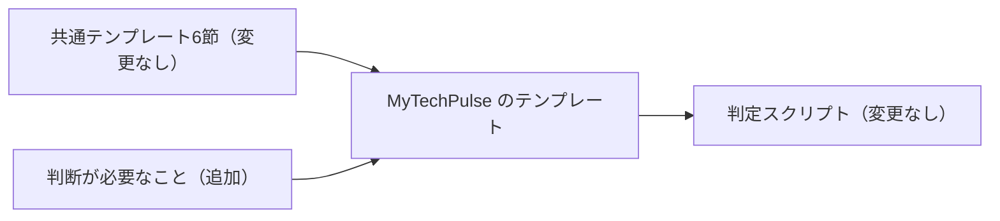

# PRテンプレートを短いブリーフィング形式にし、判断欄を残す

- 状態: 採用。[0010](0010-pr-template-v2-evidence-first.md) を置き換える
- 日付: 2026-11-13
- 決定者: Haruki。AIは起案者
- 全体の概要: [0004](0004-automerge-small-prs-by-deterministic-script.md)

## 背景と問題

- v2（[PR #300](https://github.com/H4aruki/MyTechPulse/pull/300)、[ADR 0010](0010-pr-template-v2-evidence-first.md)）は、証拠と図を先に見せる形だった。
- そのあと、poteto の opening-a-pr の日本語訳を共通テンプレートにする話が出た（出典: `/home/box/shared/pr-template/pull_request_template.ja.md`）。この形は、1分で読めるブリーフィングで、約40行以内に収める。
- MyTechPulse には、自動マージの判定が見る「判断が必要なこと」の節がある。共通テンプレートにはこの節が無い。どう合わせるかを決める必要があった。
- 案A/B/Cを提示し、Harukiさんが選んだ。

## 検討した案

| 案 | 内容 | 採否 | 採らなかった理由（採用なら採った理由） |
|---|---|---|---|
| A | 共通テンプレートの6節はそのまま使い、末尾に「判断が必要なこと」だけ足す。判定ロジックは変えない | 採用 | 6節を一字も変えずに共通化でき、判定の鍵は今まで通り判断欄に残るため |
| B | 純粋な翻訳だけにして、判定を別の節に付け替える | 不採用 | 判定ロジックと既存のテスト・運用を変える必要があり、安全装置の変更が大きくなるため |
| C | MyTechPulse は v2 のまま、新しい形は ai-dev-harness だけに入れる | 不採用 | 2つのテンプレートが分かれたままになり、共通化の目的に合わないため |

17:31 の発言で、6節を書き換えるのではなく、追加だけにすると確定した。

6節は共通テンプレートのまま、判断欄だけを足し、判定スクリプトは変えないことを示す。

## 決定

- `.github/pull_request_template.md` を、共通テンプレートの6節（なぜ / 何を変えたか / 範囲 / トレードオフ / 影響範囲 / 確認）と末尾の2つのHTMLコメントをそのまま使う形に置き換える。
- そのあとに `## 判断が必要なこと` を1節だけ足す。無いときは本文を `なし` とだけ書く。「なし」以外は自動マージ対象外。
- 判定ロジック（`scripts/automerge/eligibility-core.mjs`）は変更しない。
- 案内（`docs/pr-template.md`、`CONTRIBUTING.md`）と判定テストの見出しを、新しい節に合わせる。
- 0010 の `status` を `superseded` にし、置き換え先をこの ADR にする。
- 決めた人はHarukiさん。2026-11-13 から。MyTechPulse のPR本文すべてに適用する。

## 本人の発言

1. 2026-11-13 17:23 JST、親エージェント Kagami 経由。新しいPRテンプレート案への承認: 「LGTM」。これより長い原文は、リポジトリにも指示にも無い。
2. 2026-11-13 17:30 JST、Harukiさん本人（チャット pt344u）。案Aを選んだ発言: 「それならok.」
3. 2026-11-13 17:31 JST、Kagami 経由の本人の言葉: 「今作ったテンプレに判断が必要なことをついかするだけでいい。」（原文ママ。「ついか」は「追加」の誤変換の可能性があるが、引用では直していない）

## 理由（判断基準）

1. いちばん重い基準: 自動マージの安全装置（判断欄を鍵にした判定）を変えないこと。
2. 共通テンプレートの6節を一字も変えず、他リポジトリと同じ形で書けること。
3. レビュワーが1分で読める短さにすること。

## 根拠のデータ・事実

- 出典: `/home/box/shared/pr-template/pull_request_template.ja.md`（6節と末尾の2つのHTMLコメント）。
- 現在の判定は、`decisionSection`、見出し「判断が必要なこと」、本文が「なし」だけかを見る（`scripts/automerge/eligibility-core.mjs`、[docs/automerge.md](../automerge.md)）。見出しが無い、または「なし」以外なら `body.decision` で対象外になる。
- v2 の [PR #300](https://github.com/H4aruki/MyTechPulse/pull/300) と、ADR の書き方を足した [PR #304](https://github.com/H4aruki/MyTechPulse/pull/304) は、すでにマージ済み（2026-11-13、`git log` で確認）。
- 判定テストの確認結果は、このPRの本文の「確認」に書く。

## 結果と代償

- テンプレートは短く、レビュー向けのブリーフィングになる。
- v2 で必須だった図・テスト表は任意寄りになる。証拠（動画、スクリーンショット、構成図、UML）は、主張を支えるときだけ付ける。
- 判定の鍵はこれまで通り判断欄なので、自動マージの安全装置は維持される。
- 残る緊張: 共通テンプレートの出典コメントは「書くことがない節は消す」と言うが、判断欄は必須で消せない。出典コメントは変えず、判断欄のコメントに「必須」と書いて示す。消すと `body.decision` で対象外になるだけで、安全側に倒れる。

## 見直し方

- 自動マージ phase 0b の10本を見るときと、毎週の大きさの見直しのとき、Harukiさんが見る。
- 見る点: 本文が読みやすいか、「なし」の使い方（「なし」に寄せていないか）がずれていないか。
- ずれが見つかったら、新しいADRで置き換える。

## 関連リンク

- このPR（番号は作成後にPR本文へ記載）
- [PR #300](https://github.com/H4aruki/MyTechPulse/pull/300)、[ADR 0010](0010-pr-template-v2-evidence-first.md)、[ADR 0005](0005-eligibility-decided-by-deterministic-script.md)
- 出典: `/home/box/shared/pr-template/pull_request_template.ja.md`
- ai-dev-harness 側の対応PR: 同時に出す（番号は未確定）
