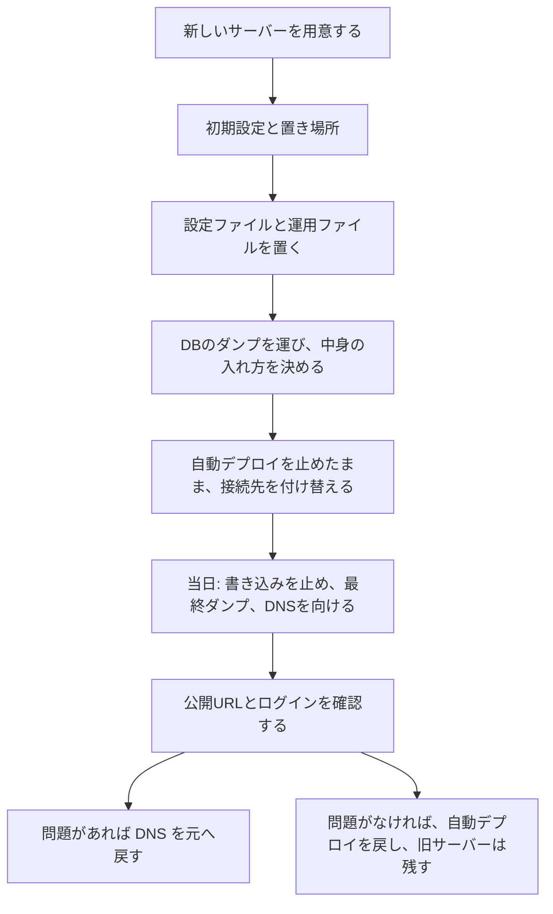

# 別のサーバーへ引っ越す手順

本番の API とデータベースを、いまの AWS Lightsail から別のサーバーへ移すときの手順です。画面（`https://mytechpulse.net`）は Cloudflare Pages のままです。移すのは、API・DB・HTTPS の窓口（Caddy）が入っている 1 台です。

- 同じ Lightsail のまま、壊れたサーバーを一から作り直すときは [lightsail-provisioning.md](lightsail-provisioning.md)。
- 通常の更新は [go-auto-deploy.md](go-auto-deploy.md)。接続に使う秘密の名前は [ci-and-release.md](ci-and-release.md)。
- バックアップの取り方と、別の名前の DB への復元は [database-backup-and-restore.md](database-backup-and-restore.md)。
- 置き場を Lightsail 1 台にした判断は [ADR 0003](../adr/0003-host-on-cloudflare-pages-and-lightsail.md)。次点は、さくらの VPS。
- メモリが理由で Lightsail の 2GB プラン（月 $12）へ上げるかは、[lightsail-provisioning.md](lightsail-provisioning.md) の 12 章。取得中のメモリの山は未測定です。

契約、支払い、ドメインの DNS をいつ向けるかは、オーナーが決めます。この資料は、その判断のあとで手を動かす順序です。作業の途中で、本番の IP アドレス、パスワード、トークン、鍵の中身を、チャット・Issue・このリポジトリに書かない。

Lightsail の画面操作の確認日は 2026-08-13、さくらの料金の記録は 2026-08-12 です。金額・プラン名・最低利用期間は変わるので、作業する日に公式のページで現在の値を見ます。

---

## 0. 全体の流れ



準備を先に済ませ、当日に止める時間を短くします。古いサーバーは、確認が終わるまで消しません。

---

## 1. 新しいサーバーを用意する（さくらの VPS を例）

ADR 0003 の次点は、さくらの VPS です。Issue #55 の本文は、Lightsail が合わなくなったときの例として、さくらのミドルプラン（月 990 円、ディスク 50GB、通信量無制限）を挙げています。2026-10-20 のコメント（2026-08-12 の公式価格の転記）では、東京の 1GB が月 990 円、石狩が月 880 円です。お試し 2 週間のあと最低 3 か月で、上のプランから下のプランへは戻せません。

同じコメントは、AI の整理であり、オーナーの決定ではありません。そこに書かれた「さくらへ乗り換える条件」は、DB を分けずに 1 台のまま運用すると決めたとき、英語の管理画面とドル払いが負担なとき、さらに円安が進んだとき、です。メモリだけが足りないときは、引っ越しより先に、Lightsail の 2GB プランを検討します（12 章へのリンクは上のとおり）。

オーナーが行うこと:

- どの事業者の、どのプランを契約するか
- 支払いと、解約できる時期（さくらは最低利用期間がある）
- ドメインの DNS を、いつ新しいサーバーへ向けるか

この資料では契約画面の操作は書きません。さくらの管理画面の現行の手順は未確認です。

サーバーの中身は、Lightsail と同じく Ubuntu 24.04 LTS を想定します。さくらの OS イメージの名前と、最初のログインユーザー名は未確認です。Lightsail の Ubuntu イメージの既定ユーザーは `ubuntu` で、ホームは `/home/ubuntu` です。ユーザー名が違う場合、このあとの `~/` は、そのユーザーのホームを指します。ホームの絶対パスは未確認です。

---

## 2. 初期設定（Lightsail の手順と違うところだけ）

土台の作り方は [lightsail-provisioning.md](lightsail-provisioning.md) にあります。次の表だけ読み替え、それ以外はそちらに従います。

| 項目 | Lightsail（作り直す手順） | 別のサーバー |
| --- | --- | --- |
| 契約と料金プラン | 有料プラン、東京、月 $7 の 1GB | オーナーが契約する。さくらの例は 1 章 |
| 固定の IP | 静的 IP をインスタンスに付ける（外したままだと課金） | 再起動で IP が変わるかは未確認。DNS を向けたあとに IP が変わると本番が落ちるので、変わらないアドレスを付ける |
| ファイアウォール | 管理画面の IPv4 / IPv6。22 は開けたまま。80/443 は Cloudflare の範囲だけ | 80/443 は同じ範囲だけにする。範囲の正本は [ops/caddy/cloudflare-ips.caddy](../../ops/caddy/cloudflare-ips.caddy)。さくらのパケットフィルタの操作は未確認。IPv6 を使うかも未確認 |
| SSH の 22 番 | 自分の IP だけに絞らない（回線が固定でないと、自分が締め出される） | 同じ。自動デプロイは GitHub Actions から SSH する（[ci.yml](../../.github/workflows/ci.yml) の「Go版の本番への反映」）。ランナーの IP は固定ではないので、22 番を自分の IP だけにすると、付け替えのあと繋がらない |
| 初期設定スクリプト | `sudo ./ops/lightsail-vm-setup.sh` | 同じスクリプトでよい。中身は Ubuntu であることだけを検査する。Docker、SSH の鍵認証、fail2ban、タイムゾーン `Asia/Tokyo` を入れる。さくらのファイアウォールとの組み合わせは未確認 |
| ログインユーザー | `ubuntu` | 違えば、スクリプトの `DOCKER_USER` にそのユーザー名を渡す |

スクリプトのあと、Lightsail の手順 5（スワップ 2GB と `vm.swappiness=10`）、手順 6（スクリプト）、手順 7（置き場所）を行います。1GB のメモリではスワップが要ります。2GB へ上げたあとにスワップを外す手順は、書いてありません。

[docker-compose.yml](../../docker-compose.yml) は 80/tcp、443/tcp、443/udp を公開します。80 と 443/tcp は、証明書の取得と API のために開けます。443/udp（HTTP/3）をファイアウォールで開ける必要があるかは未確認です。

---

## 3. サーバー上の置き場所

自動デプロイ（[ops/deploy_go.sh](../../ops/deploy_go.sh)）が既定で使う場所です。環境変数で変えられます。本番で既定以外を使っている記録は、リポジトリにはありません。

| 場所 | 役割 | 環境変数（既定はこの場所） |
| --- | --- | --- |
| `~/MyTechPulse` | リポジトリの複製。バックアップ用スクリプトの置き場所 | `MTP_BACKUP_DIR` |
| `~/releases` | 配布物を実行回ごとに展開する場所。空のディレクトリを作る | `MTP_RELEASES_ROOT` |
| `~/mytechpulse-production.env` | 本番の設定ファイル。権限は `600` | `MTP_ENV_FILE` |
| `~/deploy-in` と `~/deploy-boot` | 自動デプロイが毎回作り直す作業場所。移さない | なし（workflow が `$HOME` の下に作る） |

展開された 1 回分のディレクトリ名は `<commit_sha>-<run_id>-<run_attempt>` です（[ops/verify_release.sh](../../ops/verify_release.sh)）。compose の project 名は `mytechpulse`（`MTP_COMPOSE_PROJECT`）です。

新しいサーバーでは、次だけ先に作ります。

```bash
git clone https://github.com/H4aruki/MyTechPulse.git ~/MyTechPulse
mkdir -p ~/releases
```

いまの本番の `~/MyTechPulse` は、Python版へ戻すための古いファイルを兼ねています。ディレクトリごとコピーすると、その古いファイルまで移ります。新しいサーバーは、GitHub の `main` を複製します。古いファイルの説明は [rollback-to-python.md](rollback-to-python.md) と、Lightsail 手順の 9 章にあります。

---

## 4. 移すファイル

### 4.1 本番の設定ファイル

`~/mytechpulse-production.env` を、新しいサーバーの同じ場所へコピーします。中身は表示しません。コピーのあと、新しいサーバーで `chmod 600` を付けます。

項目の一覧は Lightsail 手順の 7 章です。ドメインを変えない引っ越しでは、`API_DOMAIN` や画面の URL は書き換えません。`ARTICLE_FETCH_ENABLED` が書いてあれば、その値のまま移ります。引っ越しのついでに、有効・無効を変えない。

データベースのロールのパスワードは、ダンプには入りません（[database-backup-and-restore.md](database-backup-and-restore.md) の「バックアップに含まれないもの」）。新しいサーバーの空の DB は、この設定ファイルの `POSTGRES_PASSWORD` で初期化されます。設定ファイルと対で移します。

手元を経由するときは、用が済んだら手元のコピーを消します。消す判断は、コピーした人（オーナー）がします。

### 4.2 docker-compose.yml と Caddyfile

動いている版の [docker-compose.yml](../../docker-compose.yml) と [Caddyfile](../../Caddyfile) は、`~/MyTechPulse` ではなく、`~/releases/<commit_sha>-<run_id>-<run_attempt>/` にあります。Caddy は同じディレクトリの `ops/caddy/` を読むので、`Caddyfile` だけを単体で移しても起動できません。`docker-compose.yml`、`Caddyfile`、`ops/` をまとめて扱います。

初回の手起動は、新しいサーバーの `~/MyTechPulse`（`main` の複製）で、Lightsail 手順の 8 章のコマンドを使います。起動する API の箱は、配布物の digest（`ghcr.io/h4aruki/mytechpulse-api-go@sha256:…`）に合わせます。箱は公開パッケージです。サーバーに GitHub のトークンは置きません。

8 章の途中にある `migrate-go` を、ダンプより先に実行するかは、5.4 の未確認事項です。決める前には実行しません。Caddy は、当日に DNS を向けてから起動します。それより前に起動すると、証明書の取得が、まだ旧サーバーを向いているドメインに対して走ります。

いま本番で動いている版が `main` より古いときは、`main` の compose と、動いている箱が合わないことがあります。そのときは、旧サーバーで動いているディレクトリをコピーします。場所は次で分かります。出力はパスだけです。

```bash
docker inspect --format '{{index .Config.Labels "com.docker.compose.project.working_dir"}}' \
  "$(docker ps -q --filter label=com.docker.compose.project=mytechpulse --filter label=com.docker.compose.service=api-go)"
```

Docker のボリューム（`db_data`、`caddy_data`、`caddy_config`）はコピーしません。DB の中身はダンプで運び、証明書は新しいサーバーで取り直します。

---

## 5. DB のダンプを運び、復元する

ダンプには利用者のパスワードハッシュなどが入ります。ファイルの中身、チェックサムの全文、接続情報は、チャットや Issue に貼りません。

### 5.1 旧サーバーで取る

リポジトリのルート（本番では `~/MyTechPulse`）で実行します。project 名は、自動デプロイと同じ `mytechpulse` にします。

```bash
cd ~/MyTechPulse
dump_path="$(COMPOSE_PROJECT_NAME=mytechpulse ./ops/backup_db.sh | tail -1)"
COMPOSE_PROJECT_NAME=mytechpulse ./ops/verify_backup.sh "$dump_path"
touch "${dump_path}.keep"
```

`ops/backup_db.sh` は custom 形式の `backups/mytechpulse_日時.dump` と、同じ名前の `.sha256` を作ります。取得と検証に成功したあと、7 日を超えた古い世代を消します。`.keep` を付けると、その世代は残ります。引っ越しが終わるまで、このダンプを消さない。

`ops/backup_db.sh` 先頭の cron の例は、ディレクトリ名が `MyTechPulse` であることを前提に、project 名を付けていません。compose の既定の project 名は、ディレクトリ名を小文字にした `mytechpulse` です。ディレクトリ名を変えた場合に同じ DB へ繋がるかは未確認です。日次の cron は、新しいサーバーの `~/MyTechPulse` に合わせます。

### 5.2 運ぶ

`.dump` と `.sha256` の 2 つを、新しいサーバーへコピーします（自分の PC を経由してよい）。権限は、新しいサーバーで本人だけが読める状態にします。Git には入れません。

ファイル名が分かる状態でのチェックサム確認は、DB が無くても次でできます。

```bash
cd <ダンプを置いたディレクトリ>
sha256sum -c <ダンプのファイル名>.sha256
```

`ops/verify_backup.sh` は、これに加えて、動いている DB コンテナの中でダンプの一覧を読みます。新しいサーバーで DB コンテナを起動したあとなら、同じ確認ができます。

### 5.3 既存の復元手順がやること

[database-backup-and-restore.md](database-backup-and-restore.md) の「5. 新しいDBへ復元」と「6. 制約・件数の確認」は、[ops/restore_db.sh](../../ops/restore_db.sh) を使います。

- 復元先の名前は `mytechpulse_restore_` で始まる新しい DB だけです。本番の名前 `mytechpulse` は拒否します。
- 同じマシン上の `mytechpulse` と、利用者・タグ・興味度の 3 表だけを比べます。セッションや記事の表は、この比較に入っていません。ダンプ自体は、そのとき `mytechpulse` にあるデータベース全体です。
- 引っ越しの前に、旧サーバーでこの復元を 1 回行い、ダンプが読めることを確かめます。復元先は本番の DB とは別の名前なので、利用者の画面には出ません。

### 5.4 新しいサーバーの `mytechpulse` へ入れる（未確認）

空の新しいサーバーで `ops/restore_db.sh` をそのまま使うと、本番の DB にはなりません。

- 宛先を `mytechpulse` にできない。
- 比べる相手は、そのマシンの `mytechpulse` です。表がまだ無い空の DB では、比較の問い合わせが失敗します。先に表を作ると、中身が空なので比較が一致せず、終了コード 4 になります。失敗したとき、スクリプトは `mytechpulse_restore_*` を消しません。
- Lightsail 手順の 8-2 も、本番の DB 名へ置き換える手順は無い、と書いてあります。

空の DB に先に移行（`migrate-go`）を掛けると表ができ、ダンプの復元とぶつかる可能性があります。ダンプを先に入れると、ダンプの中の移行の記録と、その後の `migrate-go` の関係が問題になります。どちらの順で、新しいサーバーの `mytechpulse` をダンプの中身にするかは、リポジトリに書いてありません。切り替え当日の前に、オーナーが入れ方を決めて、新しいサーバーだけで試します。確認は、API の `/health/ready` が 200 になることと、入れたデータの件数が旧サーバーと食い違わないことです。件数の見方は、入れ方と一緒に決めます。利用者名やパスワードは記録しません。

試す間、いまの本番の DB に対して復元や名前の変更をしない。

---

## 6. 自動デプロイの接続先を付け替える

秘密の値は書きません。名前だけです。登録場所は、GitHub の Settings → Secrets and variables → Actions です。

| 名前 | 種類 | 引っ越しで変えるか |
| --- | --- | --- |
| `GO_DEPLOY_ENABLED` | Variables | 作業の間は削除するか `false` にする。確認が終わってから `true` に戻す。戻しても、過去の実行は再実行されない |
| `LIGHTSAIL_HOST` | Secrets | 新しい接続先へ変える |
| `LIGHTSAIL_USER` | Secrets | ログイン名が同じなら変えない。さくらの既定ユーザーは未確認 |
| `LIGHTSAIL_SSH_KEY` | Secrets | 秘密鍵を作り直したときだけ変える。同じ鍵を新しいサーバーの `authorized_keys` に置けば、値はそのままでよい。中身は 1 行の base64 で、workflow が鍵ファイルに戻す |
| `CLOUDFLARE_API_TOKEN` | Secrets | 変えない。画面の公開に使う |
| `CLOUDFLARE_ACCOUNT_ID` | Secrets | 変えない |

`LIGHTSAIL_HOST` を変えるだけでは繋がりません。[ci.yml](../../.github/workflows/ci.yml) の「鍵と接続先の用意」が、SSH のホスト公開鍵（`ssh-ed25519`）を workflow の中に固定しています。接続先の名前は Secret から入り、鍵の中身はファイルに書いてあります。新しいサーバーは別のホスト鍵を持つので、この公開鍵を、新しいサーバーのものに書き換え、`main` に入れます。

公開鍵の見方（秘密鍵のファイルは表示しない）:

```bash
# 種類が ssh-ed25519 であることを確かめる。無ければ ssh_host_*.pub を探す
cat /etc/ssh/ssh_host_ed25519_key.pub
```

workflow に書くのは、種類と鍵の本体です。公開鍵ファイルの 3 つ目（コメント）は書きません。秘密のホスト鍵（`.pub` が付いていないファイル）をコピーして、古いサーバーと鍵を揃える方法は、リポジトリの手順にありません。

この書き換えを `main` に入れる前に、`GO_DEPLOY_ENABLED` を止めておきます。止める前に入れると、次の自動デプロイが、新しい鍵でいまのサーバーへ繋ごうとして失敗します。止めている間、`main` に入った変更は本番へ出ません。戻したあとの次の反映は、最後に成功した反映の commit から比べます（[go-auto-deploy.md](go-auto-deploy.md)）。

新しいサーバーの `~/.ssh/authorized_keys` には、次の 2 つを置きます。

- オーナーがログインする公開鍵
- 自動デプロイの公開鍵（Secret の秘密鍵と対になるもの）。手元で鍵ファイルに戻したあと、`ssh-keygen -y -f <鍵ファイル>` で公開鍵を取り出せます。画面に秘密鍵を出さない

自動デプロイは、すでに digest 付きで動いている Go 版を戻し先にします。新しいサーバーの最初の 1 回は手で起動します。コマンドは Lightsail 手順の 8 章で、`migrate-go` と Caddy の順序は 4.2 のとおりです。`docker ps` の API の箱が `…@sha256:…` になっていることを確認してから、変数を `true` に戻します。戻したあとは、画面の文言のような小さい変更を `main` に入れて、付け替え先へ入ることを見ます。

配布物を新しく作る `release.yml` の手動実行は、箱を公開の置き場へ送る操作です。オーナーが行います。

---

## 7. Cloudflare 側で変えること

画面のプロジェクト名は `mytechpulse` です（[ci.yml](../../.github/workflows/ci.yml) の「Cloudflare Pages へ公開」）。画面のドメイン `mytechpulse.net` と、Secrets の `CLOUDFLARE_API_TOKEN`、`CLOUDFLARE_ACCOUNT_ID` は変えません。

変えるのは、API のドメインの向き先です。設定ファイルの `API_DOMAIN`（例: `api.mytechpulse.net`）が指す先を、新しいサーバーにします。レコードの種類（A か AAAA か）は、リポジトリからは未確認です。向き先を変える操作はオーナーが行います。

API は Cloudflare のプロキシ経由です。根拠は、本番の接続元ヘッダーの既定が `CF-Connecting-IP` であること（[docker-compose.yml](../../docker-compose.yml)）と、Caddy が Cloudflare 以外を 403 にすることです。プロキシは外しません。新しいサーバーの 80/443 は、Cloudflare の範囲だけを許可したままにします。

証明書のボリュームは移しません。向き先を変える前は、確認の要求が旧サーバーへ届くため、新しいサーバーでは公開ドメインの証明書を取れません。Caddy は、DNS を向けたあとに起動します。Let's Encrypt の回数制限に当たらないよう、失敗した取得を何度も繰り返さない。取得できたかは、`https://api.mytechpulse.net/health/ready` が 200 になることで見ます。

TTL を事前に短くできるかは、Cloudflare の画面の現行の仕様が未確認です。向けた直後は、古い向き先が残る時間があるものとして、確認を繰り返します。

公開の場所に、いまのサーバーの IP アドレスが載っている件は Issue #251 です。引っ越しで IP が変わったら、載っている場所の扱いもオーナーが見ます。IP アドレスはこの資料に書きません。

---

## 8. 切り替え当日

前日までに、2 章から 6 章の準備（新しいサーバーの初期設定、設定ファイル、`main` の複製、ダンプの試験、ホスト公開鍵の書き換えを `main` に入れること、`GO_DEPLOY_ENABLED` が止まっていること）を終えておきます。データの入れ方（5.4）は、当日の前にオーナーが決めて、新しいサーバーで 1 回成功させておきます。

当日の順序:

1. 旧サーバーで、利用者の書き込みを止める。動いている release ディレクトリ（4.2 のコマンドで調べた場所）で、メンテナンス用の設定に切り替える。

```bash
cd <動いている release ディレクトリ>
MTP_CADDYFILE=ops/caddy/Caddyfile.maintenance \
  docker compose --env-file "$HOME/mytechpulse-production.env" -p mytechpulse \
  --profile prod up -d --force-recreate --no-deps caddy
```

`ops/caddy/Caddyfile.maintenance` は API へ中継せず、503 と短い JSON を返します。公開 URL が 503 になることを確認します。本番でこの切り替えを行った記録は、リポジトリにありません。503 にならないときは、ここで止めて原因を調べ、DNS は向けません。

2. 5.1 のコマンドで最終ダンプを取り、`.keep` を付け、検証する。このあとに旧サーバーへ入った登録やクリックは、新しいサーバーへは載りません。
3. ダンプを新しいサーバーへ運び、5.4 で決めた方法で `mytechpulse` へ入れる。
4. 新しいサーバーで API を手で起動し、サーバーの中から確認する。Caddy はまだ起動しない。

```bash
curl -s -o /dev/null -w '%{http_code}\n' http://127.0.0.1:8001/health/ready
```

200 であること。既存の利用者で、この確認用の経路からログインする手順は未確認です（公開 URL はまだ旧サーバーを向いているため）。

5. `LIGHTSAIL_HOST` を新しい接続先にしておく（自動デプロイは止めたまま）。
6. オーナーが、API ドメインの DNS を新しいサーバーへ向ける。
7. 新しいサーバーで Caddy を起動する（Lightsail 手順の 8-3）。証明書が取れるまで、次を繰り返す。

```bash
curl -s -o /dev/null -w '%{http_code}\n' https://api.mytechpulse.net/health/ready
```

8. ブラウザで、既存の利用者のログインと、記事の表示を確認する。新規の会員登録は、切り戻すと新しいサーバーにだけ残るので、確認の主には使わない。
9. 自動デプロイが成功したときに見ている URL も確認する。`https://mytechpulse.net/`、`https://mytechpulse.net/app`、`https://api.mytechpulse.net/health/ready`。
10. 問題が無ければ、9 章の切り戻しを使わず、10 章のとおり自動デプロイを戻す。旧サーバーはメンテナンスのまま残す（TTL のあいだ、遅れて届くアクセスは 503 になる）。

---

## 9. 切り戻し

新しいサーバーを消す前に、利用者を旧サーバーへ戻します。

1. オーナーが、API ドメインの DNS を旧サーバーへ戻す。
2. 旧サーバーのメンテナンスを外す。この資料の 8 章の手順 1 と同じディレクトリで、`MTP_CADDYFILE` を付けずに Caddy を起動し直す。

```bash
cd <動いている release ディレクトリ>
docker compose --env-file "$HOME/mytechpulse-production.env" -p mytechpulse \
  --profile prod up -d --force-recreate --no-deps caddy
```

3. `https://api.mytechpulse.net/health/ready` が 200 になり、既存の利用者でログインできることを確認する。
4. `LIGHTSAIL_HOST` を旧の接続先へ戻す。workflow のホスト公開鍵も、旧サーバーの公開鍵へ戻す（`main` の履歴にある。値はこの資料に書かない）。自動デプロイは、戻し終えるまで止めたままにする。
5. 新しいサーバーにだけ入った登録やクリックは、旧サーバーの DB には無い。DNS を戻すと、その分は見えなくなります。

自動デプロイの「直前の箱へ戻す」は、同じサーバーの中の話です。DNS と `LIGHTSAIL_HOST` は戻りません。

---

## 10. 確認のあと

次を全部見てから、`GO_DEPLOY_ENABLED` を `true` に戻します。

- サーバー内と、公開 URL の `/health/ready` が 200
- 既存の利用者でログインでき、記事が表示される
- API の箱が digest 付き（`@sha256:`）で動いている
- 新しいサーバーの `~/releases`、`~/mytechpulse-production.env`（権限 600）、`~/MyTechPulse/ops/backup_db.sh` と `verify_backup.sh` がある
- 日次バックアップの cron が、新しいサーバーの `~/MyTechPulse` を向いている
- workflow のホスト公開鍵が、新しいサーバーの `ssh-ed25519` と一致している
- `LIGHTSAIL_HOST` が新しい接続先である

戻したあとは、小さい変更を `main` に入れて、新しいサーバーへ入ることを確認します（[go-auto-deploy.md](go-auto-deploy.md) の 3 章）。

旧サーバーは、この確認が終わるまで消しません。消す時期はオーナーが決めます。目安として、新しいサーバーで日次バックアップが 1 回成功し、記事の定期取得（日本時間 6:00、11:30、16:30）を 1 回見てからです。これは目安であり、決定ではありません。

消すときに行うこと:

- DNS と `LIGHTSAIL_HOST` が、古い接続先を向いていないことを、もう一度見る
- 旧サーバーの cron を止めてから止める（止めたあとも、ダンプの取得が動き続けようとするため）
- Lightsail の静的 IP は、インスタンスから外したまま放置すると課金対象になる（Lightsail 手順の 3 章）。インスタンスを消すときに、静的 IP も一緒に片付ける
- さくらを契約した場合、最低利用期間のあいだは解約できない。期間は作業日に確認する
- Docker のボリュームを、確認の前に消さない
- Issue #251 のとおり、公開場所に古い IP が残っていないかを見る。IP は書かない

---

## 11. 未確認の一覧

| 項目 | 状態 |
| --- | --- |
| さくらの管理画面、OS イメージ、既定のユーザー名、ホームの絶対パス、パケットフィルタ、IPv6、443/udp | 未確認 |
| 新しいサーバーの空の `mytechpulse` へダンプを入れる順序 | 未確認。オーナーが当日の前に決める |
| Cloudflare のレコード種別と、TTL を短くする操作 | 未確認 |
| メンテナンス用 Caddy への切り替えを、本番で実行した記録 | リポジトリには無い |
| 取得中のメモリの山 | 未測定。測り方は Lightsail 手順の 12 章 |
